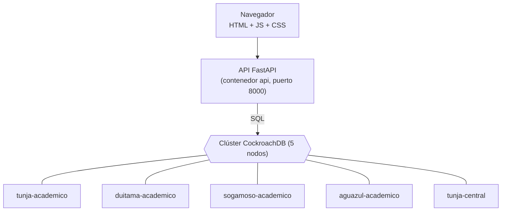
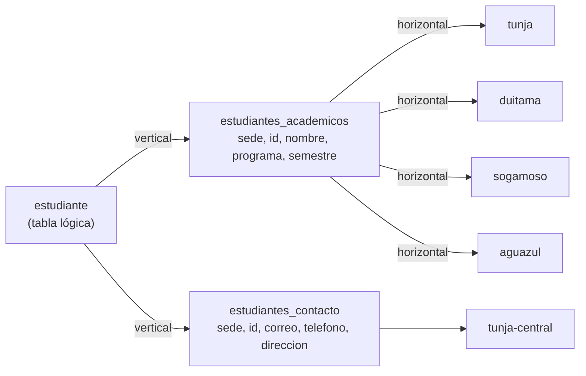

# Taller de Sharding — UPTC

Implementación y demostración de **sharding horizontal y vertical** con **CockroachDB**, a través de una app web (FastAPI + HTML/JS) que permite ver dónde vive cada dato, consultar, registrar, reconstruir registros y apagar servidores para observar qué pasa.

> Electiva I — Bases de Datos · Universidad Pedagógica y Tecnológica de Colombia
> Todos los estudiantes del proyecto son **ficticios**.

---

## Contenido

1. [Qué hicimos](#1-qué-hicimos)
2. [Arquitectura](#2-arquitectura)
3. [Cómo se fragmentaron los datos](#3-cómo-se-fragmentaron-los-datos)
4. [Estructura del repositorio](#4-estructura-del-repositorio)
5. [Cómo ejecutarlo](#5-cómo-ejecutarlo)
6. [Usar la app](#6-usar-la-app)
7. [Pruebas](#7-pruebas)
8. [Demostrar la caída de un servidor](#8-demostrar-la-caída-de-un-servidor)
9. [Explorar desde SQL](#9-explorar-desde-sql)
10. [Solución de problemas](#10-solución-de-problemas)
11. [Limitaciones y decisiones](#11-limitaciones-y-decisiones)
12. [Más documentación](#12-más-documentación)

---

## 1. Qué hicimos

Un **directorio de estudiantes** de la UPTC con cuatro sedes: **Tunja (central), Duitama, Sogamoso y Aguazul**. Cada estudiante tiene datos académicos y datos de contacto:

```
estudiante(sede, id, nombre, programa, semestre, correo, telefono, direccion)
```

Esa tabla lógica se fragmentó de dos formas:

- **Horizontal (por filas):** los datos académicos de cada sede viven en el servidor de esa sede.
- **Vertical (por columnas):** los datos de contacto se separan de los académicos y viven en un servidor central en Tunja.

**¿Por qué CockroachDB?** Es una base de datos SQL distribuida (compatible con PostgreSQL) donde el **motor** hace el sharding: nosotros declaramos los fragmentos y en qué servidor va cada uno, y la base se encarga del resto. Esto incluye las **transacciones distribuidas**: al registrar un estudiante se escribe en dos servidores a la vez, y nunca queda a medias. Versión usada: **v26.2.7**.

## 2. Arquitectura



| Nodo | Localidad | Qué guarda | SQL | Consola web |
|---|---|---|---|---|
| `tunja-academico` | `sede=tunja,rol=academico` | Datos académicos de Tunja | `localhost:26257` | http://localhost:8080 |
| `duitama-academico` | `sede=duitama,rol=academico` | Datos académicos de Duitama | `localhost:26258` | http://localhost:8081 |
| `sogamoso-academico` | `sede=sogamoso,rol=academico` | Datos académicos de Sogamoso | `localhost:26259` | http://localhost:8082 |
| `aguazul-academico` | `sede=aguazul,rol=academico` | Datos académicos de Aguazul | `localhost:26260` | http://localhost:8083 |
| `tunja-central` | `sede=tunja,rol=central` | Contactos de **todas** las sedes | `localhost:26261` | http://localhost:8084 |

Cada nodo es un contenedor Docker con su **propio volumen de datos**: son servidores independientes, aunque en la demo corran en el mismo computador. Tunja tiene dos nodos con funciones distintas, así que los dos fragmentos verticales de sus estudiantes también quedan separados.

## 3. Cómo se fragmentaron los datos



### 3.1 Fragmentación vertical — [`db/01_schema.sql`](db/01_schema.sql)

La tabla se divide en dos tablas que **comparten la clave `(sede, id)`**:

| Fragmento | Columnas | Dónde vive |
|---|---|---|
| `estudiantes_academicos` | `sede, id, nombre, programa, semestre` | Nodo de su sede |
| `estudiantes_contacto` | `sede, id, correo, telefono, direccion` | `tunja-central` |

Cumple las tres reglas de una fragmentación vertical correcta:

- **Completitud:** toda columna está en algún fragmento.
- **Reconstrucción:** un `JOIN` por `(sede, id)` devuelve el registro original.
- **Disyunción:** aparte de la clave, ninguna columna se repite.

Una llave foránea de contacto a académicos impide contactos huérfanos.

### 3.2 Fragmentación horizontal — [`db/02_horizontal.sql`](db/02_horizontal.sql)

La tabla académica se parte por la **clave de shard `sede`**:

```sql
ALTER TABLE estudiantes_academicos PARTITION BY LIST (sede) (
    PARTITION tunja    VALUES IN ('tunja'),
    PARTITION duitama  VALUES IN ('duitama'),
    PARTITION sogamoso VALUES IN ('sogamoso'),
    PARTITION aguazul  VALUES IN ('aguazul')
);
```

- La clave primaria es `(sede, id)`. Como **empieza por `sede`**, las filas de una sede quedan juntas y forman su propio bloque (*rango*).
- Un `CHECK (sede IN (...))` garantiza que cada fila pertenece a exactamente una partición.
- El índice secundario `(sede, programa)` también se particiona. Si no, sus entradas quedarían fuera de la sede.

### 3.3 Ubicación física — [`db/02_horizontal.sql`](db/02_horizontal.sql), [`db/03_vertical.sql`](db/03_vertical.sql)

Cada nodo arranca con una **localidad** (`--locality=sede=...,rol=...`, en [`docker-compose.yml`](docker-compose.yml)), y cada fragmento se fija a la localidad que le corresponde con una **zona de replicación**:

```sql
-- Partición de Tunja (tabla + índices) → solo el nodo tunja-academico
ALTER PARTITION tunja OF INDEX estudiantes_academicos@* CONFIGURE ZONE USING
    num_replicas = 1, constraints = '[+sede=tunja, +rol=academico]';

-- Tabla de contacto completa → solo el nodo tunja-central
ALTER TABLE estudiantes_contacto CONFIGURE ZONE USING
    num_replicas = 1, constraints = '[+sede=tunja, +rol=central]';
```

**¿Por qué `num_replicas = 1`?** CockroachDB copia cada dato 3 veces por defecto. Con 5 nodos, casi todo terminaría en casi todos lados y no se vería la fragmentación. Con una sola copia, cada fragmento existe **solo** en su nodo: se puede demostrar dónde está, y al apagar ese nodo, ese fragmento (y solo ese) deja de estar disponible. En producción se usarían varias réplicas dentro de cada sede (ver [sección 11](#11-limitaciones-y-decisiones)).

Los datos internos del clúster sí conservan sus réplicas, por eso el clúster sigue funcionando cuando se apaga un nodo.

## 4. Estructura del repositorio

```
├─ docker-compose.yml        # 5 nodos CockroachDB + init + api
├─ .env.example              # plantilla para la licencia (opcional)
├─ db/
│  ├─ 01_schema.sql          # tablas, restricciones, llave foránea (fragmentación vertical)
│  ├─ 02_horizontal.sql      # particiones por sede y su ubicación
│  ├─ 03_vertical.sql        # ubicación de la tabla de contacto
│  ├─ 04_seed.sql            # 100 estudiantes ficticios (Tunja 40, Duitama 25, Sogamoso 25, Aguazul 10)
│  └─ validacion/            # consultas que validan la fragmentación (las usan el script y la API)
├─ scripts/
│  ├─ init.sh                # inicializa el clúster y espera a que cada fragmento llegue a su nodo
│  └─ validar.sh             # las 6 pruebas de la sección 7
├─ backend/                  # API FastAPI (ver backend/README.md)
│  └─ tests/                 # pruebas automáticas de la API
├─ frontend/                 # interfaz HTML + JS + CSS (la sirve la misma API)
└─ docs/
   ├─ contrato.md            # acuerdo técnico: esquema, puertos, endpoints, errores
   └─ guion-demo.md          # guion de la exposición paso a paso
```

## 5. Cómo ejecutarlo

### Requisitos

- [**Docker Desktop**](https://www.docker.com/products/docker-desktop/) abierto y corriendo, con unos 6 GB de RAM disponibles para Docker.
- **Git Bash** (viene con [Git para Windows](https://git-scm.com/download/win)) para los scripts de prueba. En macOS o Linux sirve la terminal normal.
- Puertos libres: `8000`, `8080`–`8084` y `26257`–`26261`.

No hace falta instalar CockroachDB ni Python: todo corre en contenedores.

### Pasos

```bash
git clone https://github.com/CristianEslava11/Taller-CockroachDB.git
cd Taller-CockroachDB
docker compose up -d --build
```

La primera vez descarga las imágenes y tarda unos minutos. Después, levantar todo desde cero toma **alrededor de 1 minuto**. Para seguir la inicialización:

```bash
docker compose logs -f init
```

Termina con `[init] Listo.` y un resumen de estudiantes por sede. Luego abre:

| Qué | Dirección |
|---|---|
| **La app** | http://localhost:8000 |
| Documentación de la API (Swagger) | http://localhost:8000/docs |
| Consola de CockroachDB | http://localhost:8080 (y 8081–8084 para los demás nodos) |

### Qué hace `docker compose up`

1. Levanta los **5 nodos**, cada uno con su localidad.
2. El contenedor **`init`** ([`scripts/init.sh`](scripts/init.sh)):
   1. inicializa el clúster y espera a los 5 nodos;
   2. ejecuta `db/01` a `db/04`;
   3. **espera hasta que cada fragmento esté físicamente en su nodo**, comprobándolo con [`db/validacion/01_ubicacion.sql`](db/validacion/01_ubicacion.sql).

   Si la base ya existe, no la recrea.
3. Cuando `init` termina bien, arranca la **API**, que además sirve la interfaz.

### Apagar, reiniciar y borrar

```bash
docker compose stop        # apagar (conserva los datos)
docker compose up -d       # volver a encender
docker compose down -v     # borrar todo, incluidos los datos (la próxima vez se recrea desde cero)
```

## 6. Usar la app

| Sección | Qué muestra |
|---|---|
| **Distribución** | Mapa del clúster: los 5 nodos, si están disponibles y cuántos registros guarda cada uno |
| **Estudiantes** | Listado por sede (fragmento académico). Con **"Incluir EXPLAIN ANALYZE"** muestra el nodo que recibió la consulta y el nodo que **realmente leyó los datos**, por ejemplo: *Conexión: Duitama (n1) · Datos leídos en: Sogamoso (n4)* |
| **Registrar** | Registra un estudiante: escribe en dos servidores en una sola transacción y muestra dónde quedó cada parte |
| **Fragmentos** | Ubicación real de cada fragmento, consultada al clúster, y **reconstrucción** de un estudiante: parte académica + contacto = registro completo |
| **Validación** | Ejecuta las comprobaciones SQL de la fragmentación (32 comprobaciones) |

La app **no deduce** dónde están los datos: todo lo consulta al clúster con `SHOW RANGES` y `EXPLAIN ANALYZE`.

## 7. Pruebas

### 7.1 Validación del sharding desde SQL — [`scripts/validar.sh`](scripts/validar.sh)

```bash
bash scripts/validar.sh              # pruebas 1 a 6 (apaga y vuelve a encender tunja-central)
bash scripts/validar.sh --sin-fallos # solo pruebas 1 a 4
```

| # | Prueba | Qué comprueba |
|---|---|---|
| 1 | Ubicación exclusiva | Cada bloque de datos (tabla e índices) tiene una sola copia, en el nodo que le corresponde |
| 2 | Horizontal | Las filas de cada sede están en el bloque de su partición. La suma de particiones es el total, no hay filas fuera de las particiones ni `id` repetidos |
| 3 | Vertical | Los fragmentos solo comparten `sede, id`, entre los dos tienen las 8 columnas y el JOIN reconstruye cada registro, comprobado **campo por campo** con uno de prueba |
| 4 | Atomicidad | Si falla la escritura del contacto, tampoco queda la parte académica |
| 5 | Caída de `tunja-central` | Lo académico responde. Contacto, JOIN y registro fallan por tiempo límite (5 s) sin dejar datos a medias |
| 6 | Recuperación | Al encender `tunja-central` otra vez, los contactos vuelven y la validación vertical pasa |

Debe terminar con `RESULTADO: todas las pruebas pasaron.` El script deja los datos como estaban: borra sus registros de prueba y siempre vuelve a encender el nodo.

### 7.2 Desde la app o la API

La sección **Validación** de la app (o `GET /api/validaciones`) ejecuta las pruebas 1 a 3.

### 7.3 Pruebas automáticas de la API

Requieren Python 3.12. Desde la raíz del repositorio:

```bash
python -m venv backend/.venv
backend/.venv/Scripts/python -m pip install -r backend/requirements-dev.txt   # en macOS/Linux: backend/.venv/bin/python
backend/.venv/Scripts/python -m pytest backend/tests -q
```

Sin clúster pasan 27 pruebas y 5 quedan omitidas. Para incluir las pruebas contra el clúster real, que debe estar corriendo, define antes `RUN_LIVE_TESTS=1` (con el clúster pasan las 32):

- **Git Bash:** `RUN_LIVE_TESTS=1 backend/.venv/Scripts/python -m pytest backend/tests -q`
- **PowerShell:** `$env:RUN_LIVE_TESTS='1'`

Más detalles en [`backend/README.md`](backend/README.md).

## 8. Demostrar la caída de un servidor

```bash
docker compose stop tunja-central     # apaga el servidor de contactos
```

| Operación en la app | Resultado esperado | Por qué |
|---|---|---|
| Listar estudiantes de cualquier sede | ✅ Funciona normal | Los datos académicos no están en Central |
| Reconstruir un estudiante | ⚠️ Parcial: datos académicos sí, contacto no | Se pierden solo las columnas de ese servidor |
| Registrar un estudiante | ❌ Error 503 a los 5 s y **no queda nada guardado** | La transacción distribuida se revierte completa |
| Distribución / Fragmentos | Central aparece "no disponible", pero su fragmento sigue ubicado | La ubicación sale de metadatos que sí están replicados |

```bash
docker compose start tunja-central    # en unos segundos todo vuelve a la normalidad
```

También se puede apagar un nodo académico, por ejemplo `docker compose stop sogamoso-academico`. En ese caso solo deja de responder esa sede, y el listado general aparece marcado como parcial.

> ⚠️ Apaguen **un solo nodo a la vez**. Con dos apagados, algunos datos internos del clúster podrían perder quórum.

## 9. Explorar desde SQL

```bash
docker exec -it duitama-academico cockroach sql --insecure -d uptc
```

```sql
-- ¿En qué nodo está cada partición (tabla e índice)?
SELECT index_name, start_key, replica_localities
FROM [SHOW RANGES FROM TABLE estudiantes_academicos WITH INDEXES];

-- ¿Y la tabla de contacto?
SELECT index_name, replica_localities
FROM [SHOW RANGES FROM TABLE estudiantes_contacto WITH INDEXES];

-- ¿Qué nodo leyó los datos? (sql nodes = coordinador, kv nodes = dueño de los datos)
EXPLAIN ANALYZE SELECT * FROM estudiantes_academicos WHERE sede = 'sogamoso';

-- Reconstrucción vertical
SELECT a.*, c.correo, c.telefono, c.direccion
FROM estudiantes_academicos a JOIN estudiantes_contacto c USING (sede, id)
WHERE a.sede = 'aguazul';

-- Reglas de zona configuradas
SHOW ZONE CONFIGURATIONS;
```

En `start_key`, `…/1/"tunja"` es la partición `tunja` de la clave primaria y `…/2/"tunja"` la del índice. Los rangos que terminan en `/PrefixEnd` están vacíos.

## 10. Solución de problemas

| Problema | Solución |
|---|---|
| `failed to connect to the docker API` | Docker Desktop no está abierto. Ábranlo y esperen a que diga *running* |
| http://localhost:8000 no abre después de reiniciar Docker o el computador | Docker no volvió a publicar el puerto de la API. Ejecuten `docker compose up -d --force-recreate --no-deps api` |
| `init` falla o se queda esperando | Revisen `docker compose logs init`. Para empezar limpio: `docker compose down -v` y `docker compose up -d --build` |
| `port is already allocated` | Otro programa usa ese puerto. Ciérrenlo o cambien el puerto del host en `docker-compose.yml` |
| Error de rutas raras al correr scripts en Git Bash | Los scripts ya exportan `MSYS_NO_PATHCONV=1`. Si escriben comandos `docker exec` a mano, antepongan `MSYS_NO_PATHCONV=1` |
| `bad interpreter` o `\r` en los scripts | El repo fuerza finales de línea LF con `.gitattributes`. Si copiaron los archivos sin Git (por ejemplo, un ZIP editado en Windows), vuelvan a clonar el repositorio |
| Después de 7 días todo va lento | Es el límite de la licencia (sección 11). Recreen el clúster con `docker compose down -v` y `docker compose up -d --build` |

## 11. Limitaciones y decisiones

- **Una réplica por fragmento.** Sirve para demostrar la fragmentación, pero si un nodo cae, sus datos no están disponibles hasta que vuelva. En producción se usarían, por ejemplo, 3 nodos por sede con `num_replicas = 3`. Así se conserva la localidad y se tolera la caída de un servidor.
- **Un solo computador.** Los nodos son servidores independientes en contenedores. Con máquinas separadas, la configuración es la misma y solo cambian las direcciones.
- **Modo `--insecure`.** No usa TLS ni contraseñas, lo que solo es aceptable para una demo local.
- **Licencia de CockroachDB.** Desde la versión 24.3, un clúster sin licencia tiene todas las funciones durante **7 días desde que se crea**; después se limita a 5 transacciones simultáneas. Para la demo basta con recrear el clúster. Si se necesita más tiempo, existe la licencia gratuita **Enterprise Free** para estudiantes: se pega en un archivo `.env` (copiado de `.env.example`) y `init` la aplica. **Nunca suban el `.env` al repo.**
- **Consultas sin `sede`.** Deben visitar todas las particiones. La API las hace sede por sede para poder devolver resultados parciales si una no responde.

## 12. Más documentación

- [`docs/contrato.md`](docs/contrato.md): acuerdo técnico entre la base de datos y la app (esquema, reglas de ubicación, conexión, endpoints, formato de errores y comportamiento ante fallos).
- [`docs/guion-demo.md`](docs/guion-demo.md): guion de la exposición de unos 10 minutos, con plan B y preguntas probables.
- [`backend/README.md`](backend/README.md): detalles de la API, la ejecución sin Docker y las pruebas.
