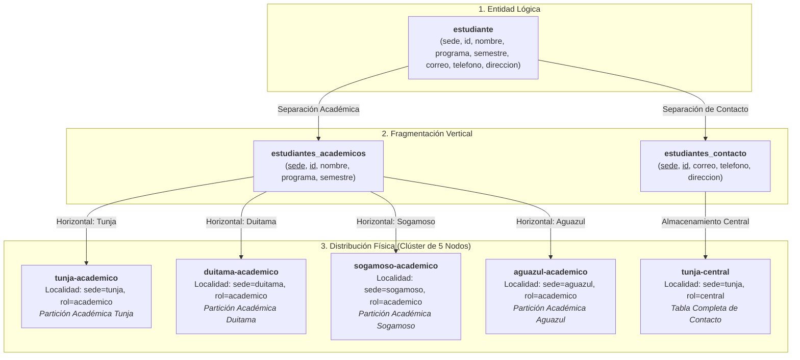
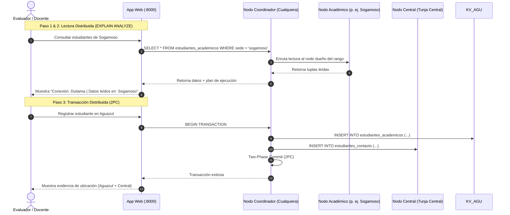

# Taller de Sharding — UPTC

> **Electiva I — Bases de Datos** · Universidad Pedagógica y Tecnológica de Colombia  
> **Tema:** Implementación de Sharding Horizontal y Vertical con CockroachDB  
> **Tecnologías:** CockroachDB v26.2.7 · Docker & Docker Compose · FastAPI · HTML5/Vanilla JS  

---

## Resumen Ejecutivo

Este taller implementa y demuestra **sharding horizontal y vertical** sobre una base de datos distribuida utilizando **CockroachDB**. A través de una aplicación web interactiva y un conjunto de pruebas automatizadas, se evidencia:
1. La ubicación física exacta de cada fragmento de datos en nodos dedicados.
2. La ejecución de **transacciones distribuidas atómicas** (2PC) al registrar entidades compuestas en múltiples servidores.
3. El enrutamiento de consultas mediante `EXPLAIN ANALYZE` (nodo coordinador vs. nodos de almacenamiento KV).
4. La **tolerancia a fallos y consistencia** del clúster ante la caída programada de servidores.

---

## 1. Modelo de Fragmentación

El caso de estudio es un **directorio de estudiantes** de la UPTC distribuido en cuatro sedes: **Tunja**, **Duitama**, **Sogamoso** y **Aguazul**.

### Esquema Lógico
$$\text{estudiante}(\underline{\text{sede}}, \underline{\text{id}}, \text{nombre}, \text{programa}, \text{semestre}, \text{correo}, \text{telefono}, \text{direccion})$$



---

### 1.1 Fragmentación Vertical — [`db/01_schema.sql`](db/01_schema.sql)

La tabla lógica se divide en dos fragmentos que comparten la clave primaria compuesta `(sede, id)`:

| Fragmento | Atributos | Servidor Destino |
| :--- | :--- | :--- |
| **`estudiantes_academicos`** | `sede, id, nombre, programa, semestre` | Nodo de la sede respectiva |
| **`estudiantes_contacto`** | `sede, id, correo, telefono, direccion` | `tunja-central` |

Este diseño cumple formalmente las tres reglas de fragmentación:
* **Completitud:** Toda columna del esquema lógico pertenece a alguno de los fragmentos.
* **Reconstrucción:** La unión relacional mediante un `NATURAL JOIN` o `JOIN ON (sede, id)` restituye la entidad completa sin pérdida de información.
* **Disyunción:** Los atributos no clave son mutuamente excluyentes entre ambos fragmentos. Una llave foránea en `estudiantes_contacto` previene registros huérfanos.

---

### 1.2 Fragmentación Horizontal — [`db/02_horizontal.sql`](db/02_horizontal.sql)

La tabla académica se fragmenta por partición de lista utilizando la columna `sede` como clave de partición:

```sql
ALTER TABLE estudiantes_academicos PARTITION BY LIST (sede) (
    PARTITION tunja    VALUES IN ('tunja'),
    PARTITION duitama  VALUES IN ('duitama'),
    PARTITION sogamoso VALUES IN ('sogamoso'),
    PARTITION aguazul  VALUES IN ('aguazul')
);
```

* **Clave Primaria Compuesta:** Al iniciar con `sede` (`PRIMARY KEY (sede, id)`), las tuplas de una misma sede se almacenan contiguas en el mismo rango de almacenamiento (Range).
* **Particionamiento de Índices:** El índice secundario `(sede, programa)` también está particionado para evitar accesos cruzados entre nodos durante búsquedas por programa.

---

### 1.3 Ubicación Física y Zonas de Replicación — [`db/03_vertical.sql`](db/03_vertical.sql)

Cada contenedor CockroachDB arranca con una etiqueta geográfica (`--locality=sede=...,rol=...`). Mediante **Replication Zones**, se ancla cada partición a su nodo respectivo:

```sql
-- Partición de Tunja asignada exclusivamente a tunja-academico
ALTER PARTITION tunja OF INDEX estudiantes_academicos@* CONFIGURE ZONE USING
    num_replicas = 1, constraints = '[+sede=tunja, +rol=academico]';

-- Tabla de contactos asignada exclusivamente a tunja-central
ALTER TABLE estudiantes_contacto CONFIGURE ZONE USING
    num_replicas = 1, constraints = '[+sede=tunja, +rol=central]';
```

> **Nota metodológica:** Se configuró intencionalmente `num_replicas = 1` para aislar cada fragmento en su servidor físico respectivo. De este modo, la caída de un servidor evidencia de forma tangible la indisponibilidad de su fragmento correspondiente.

---

## 2. Inicio Rápido (Quickstart)

### Requisitos Previos
* [Docker Desktop](https://www.docker.com/products/docker-desktop/) corriendo con al menos 6 GB de RAM asignados.
* Puertos libres en el host: `8000`, `8080`–`8084` y `26257`–`26261`.

### Despliegue en 1 Minuto

```bash
# 1. Clonar el repositorio
git clone https://github.com/CristianEslava11/Taller-CockroachDB.git
cd Taller-CockroachDB

# 2. Construir e iniciar el clúster (5 nodos CockroachDB + inicializador + API web)
docker compose up -d --build
```

Para monitorear la inicialización y migración automática de datos:
```bash
docker compose logs -f init
```
*(Finaliza automáticamente con el mensaje `[init] Listo.`)*

### Puntos de Acceso

| Interfaz | URL | Descripción |
| :--- | :--- | :--- |
| **Aplicación Web** | [http://localhost:8000](http://localhost:8000) | Dashboard interactivo de monitoreo y pruebas |
| **API Docs (Swagger)** | [http://localhost:8000/docs](http://localhost:8000/docs) | Documentación interactiva de la API FastAPI |
| **Consola CockroachDB** | [http://localhost:8080](http://localhost:8080) | Panel nativo del clúster (nodos 8080 al 8084) |

---

## 3. Guía de Evaluación para el Docente

La aplicación web cuenta con herramientas integradas para validar los principios de bases de datos distribuidas en vivo:



### Paso 1: Distribución Física de Fragmentos
1. Ingrese a la app web en la pestaña **Distribución**.
2. Verifique el estado de los 5 nodos y la carga de registros por sede: Tunja (40), Duitama (25), Sogamoso (25), Aguazul (10) y Central (100 contactos).
3. En la pestaña **Fragmentos**, confirme que la ubicación esperada y la observada mediante `SHOW RANGES` coinciden de forma exacta.

### Paso 2: Lectura Distribuida y `EXPLAIN ANALYZE`
1. Vaya a la pestaña **Estudiantes**.
2. Seleccione una sede específica (por ejemplo, **Sogamoso**) y active la casilla **«Incluir EXPLAIN ANALYZE»**.
3. Haga clic en **Consultar**.
4. Observe la evidencia de ejecución:
   * **Nodo de Conexión (SQL Coordinator):** El nodo que recibió la petición HTTP (puede ser cualquiera del clúster).
   * **Nodo Lector (KV Reader):** Únicamente el nodo correspondiente a la sede solicitada (`sogamoso-academico`). La consulta no realiza escaneos globales ni toca nodos ajenos.

### Paso 3: Transacción Distribuida Atómica y Reconstrucción
1. Ingrese a la pestaña **Registrar**.
2. Registre un nuevo estudiante (por ejemplo, en la sede **Aguazul**).
3. La interfaz mostrará cómo un único registro disparó una **transacción distribuida** escribiendo en dos servidores simultáneamente (`aguazul-academico` para datos académicos y `tunja-central` para contacto).
4. En la pestaña **Fragmentos**, use la herramienta de **Reconstrucción** para observar la reconstrucción relacional en vivo ($V_1 \bowtie V_2$).

### Paso 4: Tolerancia a Fallos y Aislamiento de Errores
Simule la desconexión del servidor central de contactos desde la terminal:

```bash
docker compose stop tunja-central
```

Compruebe el comportamiento del clúster en la app web:
* **Lecturas Académicas:** La consulta de estudiantes por sede continúa respondiendo con normalidad (aislamiento de fallos).
* **Reconstrucción de Registros:** Se genera una respuesta parcial (datos académicos intactos, datos de contacto no disponibles).
* **Registro de Nuevos Estudiantes:** La transacción distribuida es abortada atómicamente tras el tiempo límite (5 s, código HTTP `503`), garantizando que **no se guarden datos huérfanos o a medias**.

Para restaurar el servicio:
```bash
docker compose start tunja-central
```

---

## 4. Validación Automatizada

El repositorio incluye un script de validación automatizada que ejecuta **32 comprobaciones SQL formales** y pruebas de estrés:

```bash
# Ejecutar la suite completa de pruebas (incluye caída y recuperación de servidor)
bash scripts/validar.sh

# Ejecutar únicamente las pruebas de consistencia sin apagar nodos
bash scripts/validar.sh --sin-fallos
```

### Matriz de Pruebas

| # | Prueba | Criterio de Aceptación |
| :-: | :--- | :--- |
| **1** | **Ubicación Exclusiva** | Cada rango físico de datos reside únicamente en el nodo asignado por su restricción de zona. |
| **2** | **Fragmentación Horizontal** | Cada partición almacena exclusivamente filas de su sede. No existen tuplas huérfanas ni claves duplicadas. |
| **3** | **Fragmentación Vertical** | Los fragmentos comparten únicamente la clave compuesta `(sede, id)`. El `JOIN` reconstruye el 100% de los datos originales. |
| **4** | **Atomicidad Distribuida** | Si la inserción en el nodo central falla, la inserción académica se revierte automáticamente (Rollback). |
| **5** | **Resiliencia ante Caída** | Al detener `tunja-central`, las consultas académicas responden en tiempo normal; las operaciones dependientes de contacto fallan limpiamente. |
| **6** | **Recuperación Automática** | Al reiniciar el nodo caído, el clúster reanuda la reconstrucción completa sin intervención manual. |

---

## 5. Estructura del Repositorio

```text
├── docker-compose.yml          # Definición de los 5 nodos CockroachDB + init + API web
├── db/
│   ├── 01_schema.sql           # Esquema base, tablas y clave foránea (Fragmentación Vertical)
│   ├── 02_horizontal.sql       # Particionamiento por LIST(sede) y restricciones de zona
│   ├── 03_vertical.sql         # Asignación de zona física para la tabla de contactos
│   ├── 04_seed.sql             # Semilla con 100 estudiantes ficticios
│   └── validacion/             # Consultas SQL que auditan la fragmentación
├── scripts/
│   ├── init.sh                 # Script de orquestación, bootstrap y verificación inicial
│   └── validar.sh              # Suite de 6 pruebas automatizadas de sharding y tolerancia a fallos
├── backend/                    # API desarrollada en FastAPI (psycopg3 + pool de conexiones)
│   └── tests/                  # Pruebas unitarias y de integración de la API
├── frontend/                   # Interfaz de usuario (HTML5, Vanilla JS, CSS responsivo)
└── docs/
    ├── contrato.md             # Especificación técnica formal (esquemas, puertos, códigos de error)
    └── guion-demo.md           # Guión paso a paso para sustentación oral (≈ 10 minutos)
```

---

<details>
<summary><b>▶ Anexo A: Exploración Directa desde Cockroach SQL</b></summary>

<br>

Puede interactuar directamente con la consola SQL de cualquiera de los nodos usando Docker:

```bash
docker exec -it duitama-academico cockroach sql --insecure -d uptc
```

**Consultas útiles para auditar el clúster:**

```sql
-- 1. Inspeccionar en qué nodo físico está cada rango y partición
SELECT index_name, start_key, replica_localities
FROM [SHOW RANGES FROM TABLE estudiantes_academicos WITH INDEXES];

-- 2. Inspeccionar la ubicación de la tabla de contacto
SELECT index_name, replica_localities
FROM [SHOW RANGES FROM TABLE estudiantes_contacto WITH INDEXES];

-- 3. Analizar el plan de ejecución y el nodo KV que procesa la lectura
EXPLAIN ANALYZE SELECT * FROM estudiantes_academicos WHERE sede = 'sogamoso';

-- 4. Reconstrucción vertical manual mediante JOIN
SELECT a.sede, a.id, a.nombre, a.programa, c.correo, c.telefono
FROM estudiantes_academicos a 
JOIN estudiantes_contacto c USING (sede, id)
WHERE a.sede = 'aguazul';

-- 5. Listar las configuraciones de zonas activas
SHOW ZONE CONFIGURATIONS;
```

</details>

<details>
<summary><b>▶ Anexo B: Pruebas Unitarias de la API (Pytest)</b></summary>

<br>

Para ejecutar la suite de pruebas del backend en un entorno de desarrollo local (requiere Python 3.12):

```bash
# Crear y activar entorno virtual
python -m venv backend/.venv
source backend/.venv/bin/activate       # En Windows: backend\.venv\Scripts\activate

# Instalar dependencias de prueba
pip install -r backend/requirements-dev.txt

# Ejecutar pruebas unitarias (27 pruebas sin clúster)
pytest backend/tests -q

# Ejecutar las 32 pruebas completas (con el clúster de Docker activo)
RUN_LIVE_TESTS=1 pytest backend/tests -q
```

Para más detalles, consulte la documentación interna en [`backend/README.md`](backend/README.md).

</details>

<details>
<summary><b>▶ Anexo C: Solución de Problemas Frecuentes y Decisiones Técnicas</b></summary>

<br>

| Situación | Causa / Solución |
| :--- | :--- |
| `failed to connect to the docker API` | Docker Desktop no está en ejecución. Inicie la aplicación de Docker y reintente. |
| El puerto `8000` o `8080` ya está en uso | Hay otro proceso ocupando los puertos. Deténgalo o modifique el mapeo en `docker-compose.yml`. |
| La API no responde tras reiniciar Docker | Ejecute: `docker compose up -d --force-recreate --no-deps api`. |
| Limpiar completamente el clúster y recrearlo | Ejecute `docker compose down -v` seguido de `docker compose up -d --build`. |
| Advertencia de licencia (límite de 7 días) | CockroachDB v24+ incluye 7 días de funcionalidad Enterprise completa por clúster. Al recrear el clúster con `docker compose down -v` el contador se reinicia en cero. Si requiere uso extendido, puede incluir una llave estudiantil gratuita en `.env` (siguiendo `.env.example`). |

</details>
